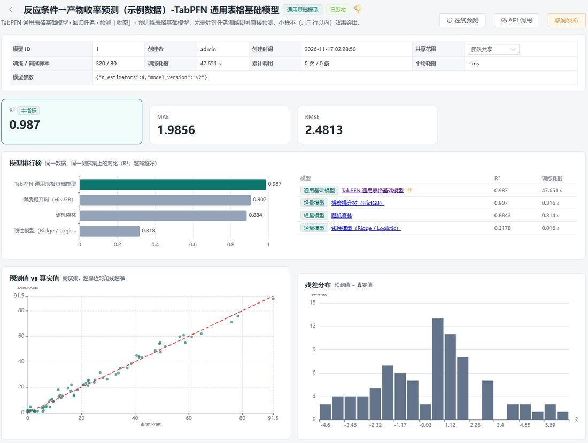
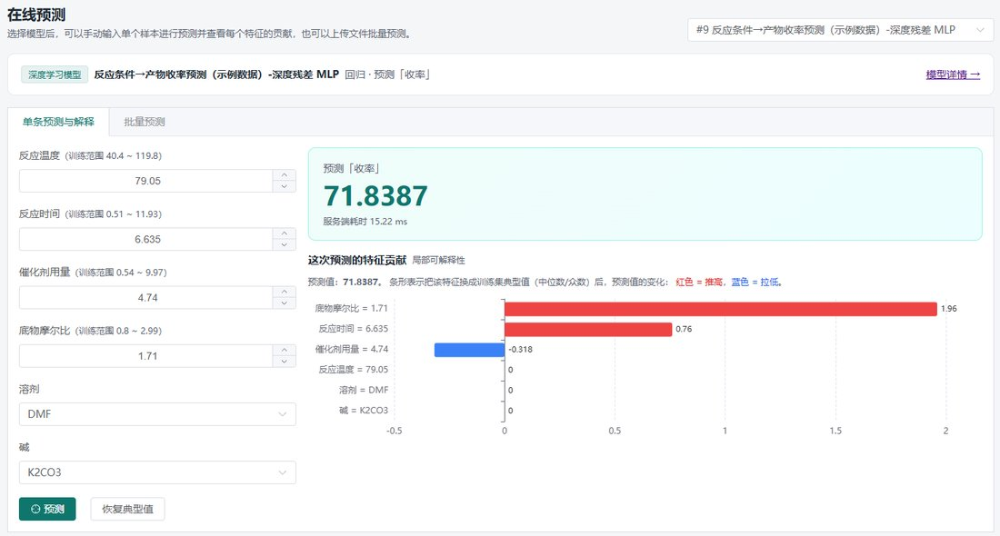
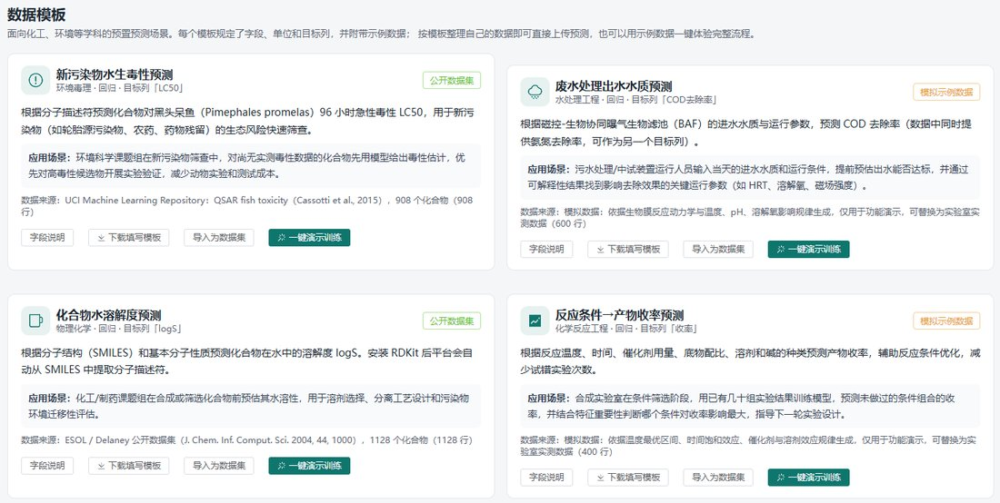
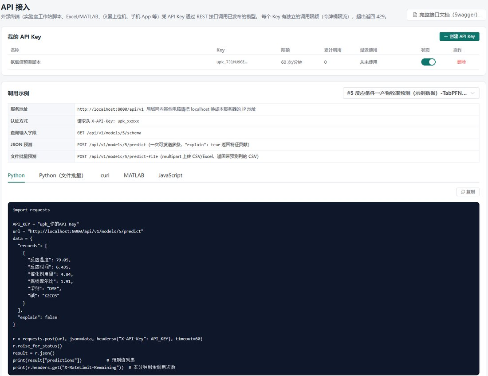
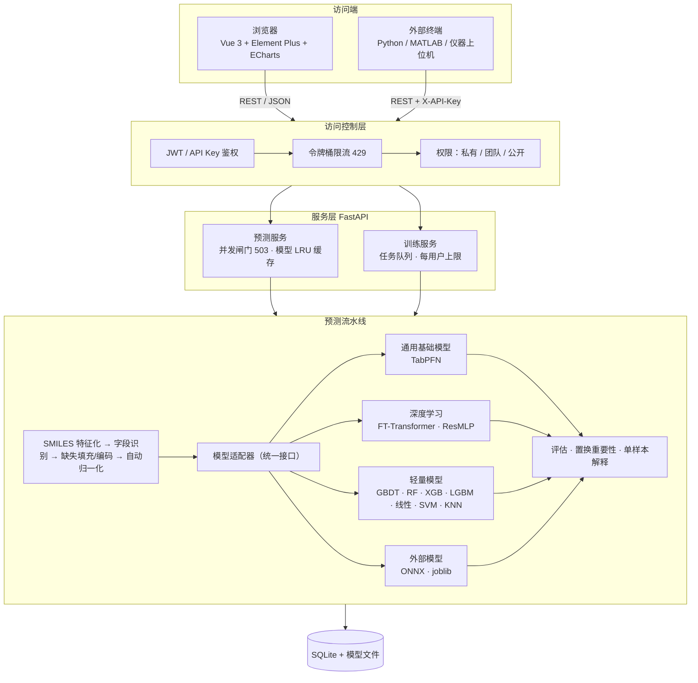
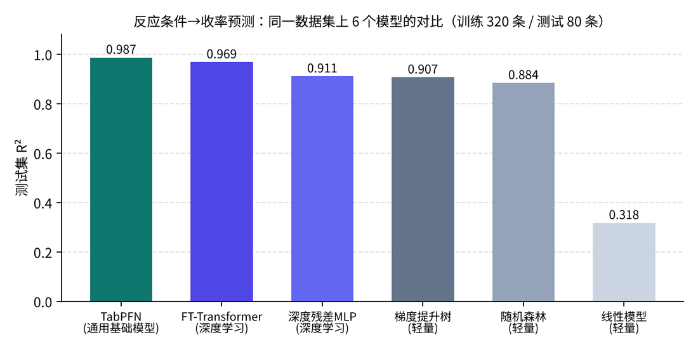
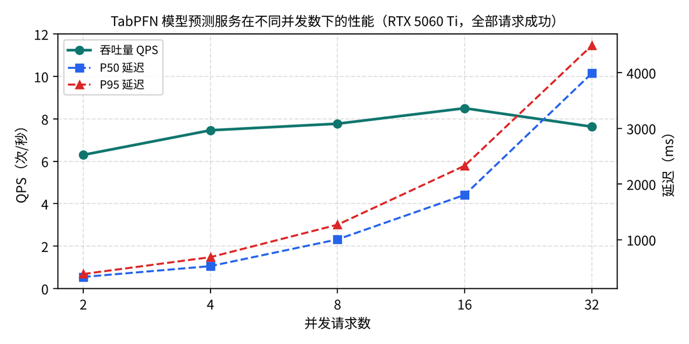

<div align="center">

# UniPredict · 通用模型预测服务平台

**基于服务器端通用模型的可访问式深度学习预测服务设计**

重庆理工大学 2025 年本科生交叉创新培育项目 · 指导教师：邢志林 副教授

[](http://8.156.66.225/)
[](http://8.156.66.225/docs)


</div>

---

在服务器上训练、部署一组**通用基础模型和轻量模型**，通过 **REST API 和网页界面**为外部终端提供预测服务。平台内置化工/环境**数据模板**、**自动归一化**、**模型适配器**和**可解释性模块**，用户最少只需"上传数据 → 选择目标列 → 一键预测"三步。平台重点解决了**模型接入、并发访问控制和结果可视化**三个问题，跨学科团队可以在同一个平台上开展预测任务。

## 🔗 链接

| | 地址 |
|---|---|
| 🌐 在线平台 | **http://8.156.66.225/** （用邮箱注册即可，无需验证码） |
| 📖 在线接口文档 | http://8.156.66.225/docs |
| 💻 源代码 | https://github.com/wangshiyun72/unipredict |

> 在线平台部署在阿里云 ECS（2 核 CPU / 4 GB 内存）上。4 个数据模板的最优模型已经公开，注册后就能直接用来预测。

## ✨ 功能

| 模块 | 说明 |
|---|---|
| 🧠 **服务器端通用 / 轻量模型** | 4 类共 11 种模型。**通用基础模型** TabPFN；**深度学习** FT-Transformer、深度残差 MLP；**轻量模型** 梯度提升树、随机森林、XGBoost、LightGBM、线性模型、SVM、KNN；外加一个插件示例模型 |
| 🪄 **一键预测** | 三步向导：上传数据 → 选择目标列 → 多个模型自动训练比较，最优模型自动发布，并完成批量预测 |
| 📋 **数据模板** | 新污染物水生毒性、废水处理出水水质、化合物溶解度、反应条件→收率，共 4 个化工/环境场景，每个模板带字段说明和示例数据 |
| ⚖️ **自动归一化** | 自动识别字段类型（数值 / 类别 / 日期 / SMILES / ID），SMILES 自动转换为 RDKit 分子描述符，自动选择缩放方式并生成归一化报告 |
| 🔌 **模型适配器** | 所有模型通过统一接口接入；新模型以插件形式放进目录即可识别；也支持导入外部 ONNX / joblib 模型 |
| 🔍 **可解释性** | 全局置换重要性 + 单样本特征贡献，与模型类型无关 |
| 🌐 **REST API** | 40 余个接口，API Key 鉴权，支持 JSON / 文件批量预测，提供 Python / curl / MATLAB / JS 调用示例 |
| 🚦 **并发访问控制** | 令牌桶限流（429）+ 预测并发闸门（503）+ 训练任务队列 + GPU 并发锁 + 模型缓存 |
| 📊 **结果可视化** | 排行榜、预测值 vs 真实值、残差、混淆矩阵、特征重要性、训练曲线、调用趋势、实时并发监控 |
| 👥 **团队协作** | 邮箱注册、团队划分，数据和模型可设为私有 / 团队共享 / 全平台公开 |

## 🖼️ 界面

| 模型详情：指标、排行榜、预测 vs 真实 | 在线预测与单样本解释 |
|---|---|
|  |  |
| **化工/环境数据模板** | **API 接入：Key 管理与多语言示例** |
|  |  |

## 🏗️ 架构



## 📈 测试结果

**各数据模板上的模型对比**（测试集 R²，在云服务器 CPU 上训练）

| 数据模板 | TabPFN | 梯度提升树 | 随机森林 | 线性模型 |
|---|---|---|---|---|
| 新污染物水生毒性（908 条，公开数据） | **0.650** | 0.587 | 0.581 | 0.564 |
| 废水处理出水水质（600 条，模拟数据） | **0.944** | 0.872 | 0.777 | 0.603 |
| 化合物溶解度（1128 条，公开数据） | **0.909** | 0.870 | 0.868 | 0.776 |
| 反应条件→收率（400 条，模拟数据） | **0.987** | 0.907 | 0.885 | 0.318 |

不经过任何调参，通用基础模型 TabPFN 在 4 个不同学科的小样本数据集上都是最优。

<p align="center"></p>

**并发压力测试**（RTX 5060 Ti 工作站，TabPFN 模型，测试脚本见 `backend/scripts/benchmark.py`）

| 实验 | 方法 | 结果 |
|---|---|---|
| 并发性能 | 并发数 2～32，每级持续 10 秒 | 吞吐量稳定在 6.3～8.5 次/秒，请求全部成功，多出的请求排队，延迟线性增加 |
| 限流验证 | API Key 限额 60 次/分钟，瞬间发送 120 个请求 | 68 个放行，52 个返回 429 |
| 并发闸门 | 64 个客户端同时请求，每个请求 2000 条样本 | 服务端峰值并发 8，等于设定上限；排队超时的请求返回 503 |

<p align="center"></p>

## 🔌 API 调用示例

在网页「API 接入」页面创建 API Key，在「模型仓库」中查看模型 ID，然后：

```python
import requests

BASE = "http://8.156.66.225/api/v1"
headers = {"X-API-Key": "upk_你的API Key"}

# 查询模型需要哪些输入字段
schema = requests.get(f"{BASE}/models/13/schema", headers=headers).json()

# 预测（一次可发送多条），explain=True 同时返回每个特征的贡献
r = requests.post(f"{BASE}/models/13/predict", headers=headers, json={
    "records": [{"反应温度": 85, "反应时间": 6, "催化剂用量": 5,
                 "底物摩尔比": 1.5, "溶剂": "DMF", "碱": "Cs2CO3"}],
    "explain": True,
})
print(r.json()["predictions"])
```

> 模型 #13 是在线平台上"反应条件→收率"模板的公开模型。完整接口说明见 [在线接口文档](http://8.156.66.225/docs)。

## 🚀 部署

**云服务器（Ubuntu 22.04，一条命令）**

```bash
git clone https://github.com/wangshiyun72/unipredict.git /opt/unipredict && bash /opt/unipredict/deploy/install.sh
```

脚本会自动安装 CPU 版 PyTorch 和其他依赖，训练并公开演示模型，再注册成系统服务。详见 [docs/云服务器部署.md](docs/云服务器部署.md)。

**本机（Windows + NVIDIA 显卡）**

| 步骤 | 操作 |
|---|---|
| 1 | 安装 Node.js 22 LTS 和 Anaconda |
| 2 | 在 Anaconda Prompt 里运行 `setup_backend.bat`（会安装 CUDA 12.8 版 PyTorch） |
| 3 | 运行 `setup_frontend.bat` |
| 4 | 运行 `start_backend.bat` + `start_frontend.bat`，打开 http://localhost:5173 |

详见 [docs/部署说明.md](docs/部署说明.md)。

## 📁 目录结构

```
├── backend/                 后端（Python / FastAPI）
│   ├── app/core/            算法核心：自动归一化、模型适配器、评估与可解释性、训练流程
│   │   └── adapters/        模型适配器（通用 / 深度 / 轻量 / 外部），plugins/ 放自定义模型
│   ├── app/routers/         REST API
│   ├── app/services/        数据集、数据模板、模型仓库、训练服务
│   ├── app/concurrency.py   限流与并发闸门
│   ├── app/tasks.py         训练任务队列
│   └── scripts/             压测、初始化演示模型、重置密码、环境检查、API 调用示例
├── frontend/                前端（Vue 3 + Element Plus + ECharts）
├── deploy/install.sh        Linux 云服务器一键部署
└── docs/                    文档
```

## 📚 文档

- [系统设计说明](docs/系统设计说明.md)：架构，以及项目简介各项要求的实现方式
- [模型接入指南](docs/模型接入指南.md)：写适配器插件，或导入 ONNX / joblib 模型
- [部署说明（本机）](docs/部署说明.md)：Windows 安装、局域网访问、配置项、压测、常见问题
- [云服务器部署](docs/云服务器部署.md)：阿里云 ECS 部署与日常维护

## 🙏 致谢

- [TabPFN](https://github.com/PriorLabs/TabPFN)（Hollmann et al., *Nature* 2025）：表格基础模型
- FT-Transformer（Gorishniy et al., NeurIPS 2021）：表格深度学习模型
- 数据集：[UCI QSAR fish toxicity](https://archive.ics.uci.edu/dataset/504/qsar+fish+toxicity)（Cassotti et al., 2015）、ESOL（Delaney, 2004）

## 📄 许可证

[MIT License](LICENSE)
