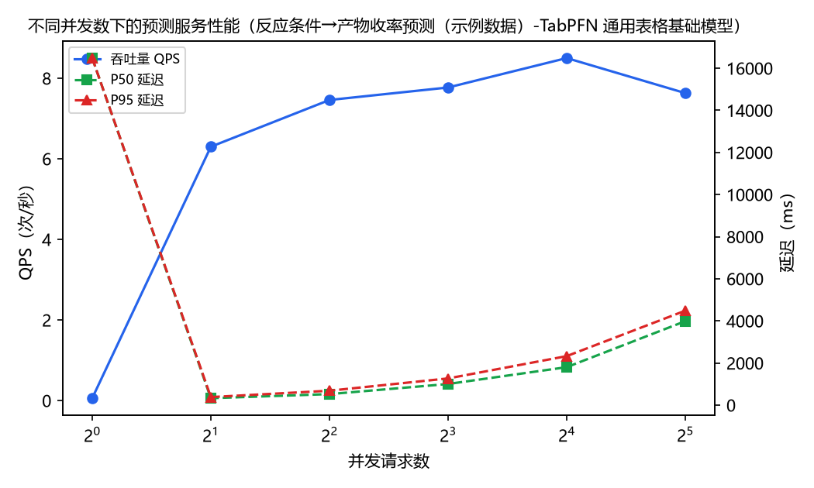

# 预测服务并发压测报告（20261117_132008）

- 模型：#1 反应条件→产物收率预测（示例数据）-TabPFN 通用表格基础模型
- 服务地址：http://127.0.0.1:8000
- 每请求样本数：1

## 实验1 并发性能

| 并发数 | 请求数 | 成功 | QPS | P50 (ms) | P95 (ms) | P99 (ms) |
|---|---|---|---|---|---|---|
| 1 | 1 | 1 | 0.06 | 16481.81 | 16481.81 | 16481.81 |
| 2 | 64 | 64 | 6.3 | 329.69 | 382.71 | 413.43 |
| 4 | 77 | 77 | 7.46 | 524.27 | 685.49 | 734.37 |
| 8 | 84 | 84 | 7.77 | 1004.32 | 1268.53 | 1327.6 |
| 16 | 100 | 100 | 8.5 | 1803.84 | 2328.15 | 2542.8 |
| 32 | 107 | 107 | 7.63 | 3988.07 | 4487.3 | 4637.32 |

## 实验2 限流验证

API Key 限额 60 次/分钟（令牌桶），瞬间并发发送 120 个请求：

| 状态码 | 数量 | 含义 |
|---|---|---|
| 200 | 68 | 放行 |
| 429 | 52 | 超过限额被拒绝 |

## 实验3 并发闸门

64 个客户端同时发送大批量请求（每请求 2000 条），服务端同时执行的预测数被限制在 8 以内，其余请求排队；排队超过设定时间返回 503。

- 客户端状态码分布：{200: 83, 503: 1}
- 服务端峰值并发：8 / 上限 8
- 成功请求 P50 / P95 延迟：19465.15 / 28076.63 ms
